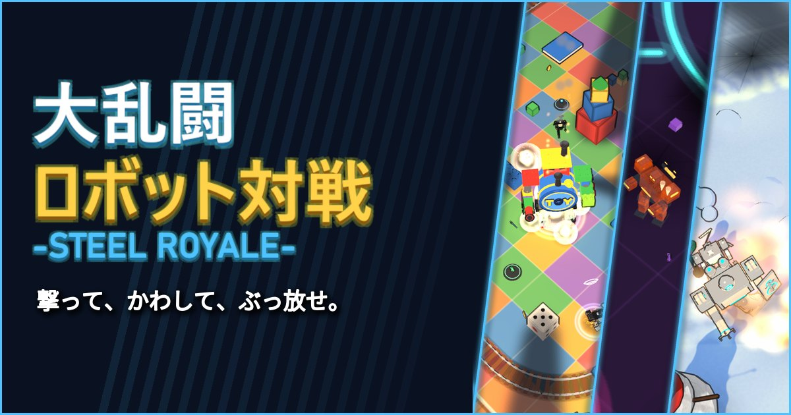

<a href="https://enyaorc.github.io/SteelRoyale-feedback/"><b>▶ 公式サイト</b></a>　｜　<a href="https://unityroom.com/games/steelroyale"><b>▶ unityroom で遊ぶ</b></a>

26 体のロボットが入り乱れる、見下ろし型の 3D 対戦アクション。 ゲームの紹介は、<a href="https://enyaorc.github.io/SteelRoyale-feedback/">公式サイト</a>をご覧ください。

## このリポジトリについて

- 不具合の報告と要望の置き場です。issue と公式サイトだけを置いています。
- ゲーム内のチャットなどで寄せられた不具合や要望を、開発者がここに一覧（issue）でまとめています。
- 直したものは、何を直したかを書いて「対応済み」にします。ゲームへの反映は、次の更新からです。
- [対応待ちの不具合・要望](https://github.com/enyaorc/SteelRoyale-feedback/issues)　｜　[対応済みの不具合・要望](https://github.com/enyaorc/SteelRoyale-feedback/issues?q=is%3Aissue%20state%3Aclosed)

※ 画像・仕様は開発中のものです。実際の製品とは異なる場合があります。

