
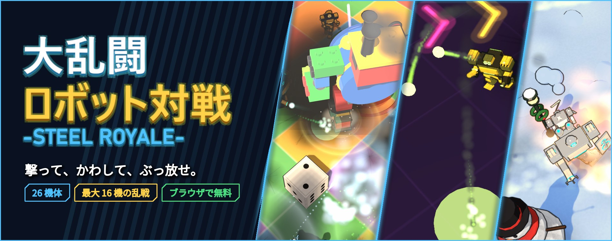

※ 画像・仕様は開発中のものです。実際の製品とは異なる場合があります。

<b>コインを奪い合え。拠点を取れ。巨大ボスに挑め。</b>

<a href="#about">ゲーム紹介</a> ・ <a href="#modes">モード</a> ・ <a href="#maps">マップ</a> ・ <a href="#mechs">機体</a> ・ <a href="#howto">遊び方</a> <a href="#progress">集めて育てる</a> ・ <a href="#story">ストーリー</a> ・ <a href="#feedback">このリポジトリについて</a>

 

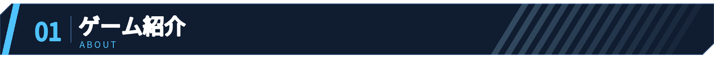

通常攻撃・3 つのスキル・ULT（ウルト）。機体ごとにまったく違う技で戦う、見下ろし型の 3D 対戦アクション。

<table align="center">
<tr>
<td width="50%"><b>26 機体・6 ロール</b> アサルト／タンク／アサシン ファイター／シューター／サポート お気に入りの 1 機を見つけよう。</td>
<td width="50%"><b>6 つのマップ</b> シングルは、市街地・砂漠・溶鉱炉。 マルチプレイは、 トイボックス・カジノパーティー・ スノーホリデーが順番に回ってくる。</td>
</tr>
<tr>
<td><b>最大 16 機のマルチプレイ</b> 人とボットを合わせて 16 機の大乱戦。 チャットで話しながら遊べる。</td>
<td><b>課金なし</b> ガチャもスキンも、 遊んで集めたコインと素材だけ。</td>
</tr>
</table>

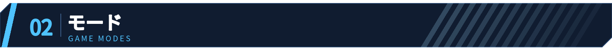

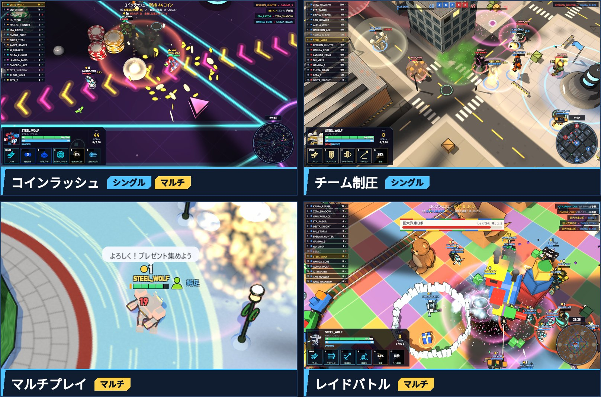

**コインラッシュ**　マップのコインを拾い、敵を倒して奪い取れ。倒された機体は、持っていたコインの半分をばらまく。集めたコインが増えると、セットしておいた「コイン報酬」（ガトリングや巨大バズーカなど）が使えるようになる。

**チーム制圧**　青と赤に分かれて、5 つの拠点を奪い合う。決め手は撃破より陣取り。仲間と前線を押し上げて、先に目標点へ。

**マルチプレイ**　ほかのプレイヤーとコインラッシュ。1 部屋は 16 機で、30 分ごとに次のマップへ。チャットの発言は、機体の上にフキダシで出る。

**レイドバトル**　トイボックスで汽車を壊すと……空から巨大汽車ロボが降ってくる！ その間だけは全員が味方。力を合わせて倒し、ダメージ 1 位を狙え。

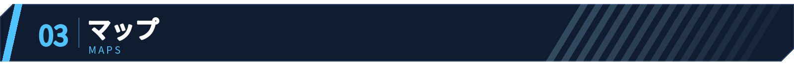

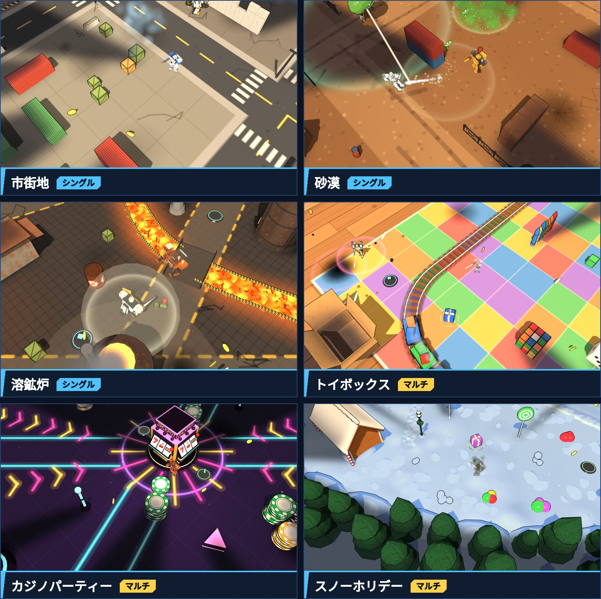

**市街地**（シングル）　ビルと交差点が並ぶ、王道の市街戦。

**砂漠**（シングル）　重機と廃材が転がる、乾いたスクラップ採掘場。

**溶鉱炉**（シングル）　溶岩が流れる灼熱の廃工場。足もとに注意。

**トイボックス**（マルチ）　おもちゃ箱の中で戦うステージ。線路を走る汽車にひかれると、大きく吹き飛ばされてコインをばらまく。その汽車を壊すと……？

**カジノパーティー**（マルチ）　ピンボール台のようなカジノ。ポヨンバンパーで弾き飛ばされ、大砲フリッパーで中央へひとっ飛び。ジャックポットスロットに攻撃を当てて回そう。何が出るかな？

**スノーホリデー**（マルチ）　雪の積もった村。サンタさんからのプレゼントを集めよう。巨大な雪玉に気をつけて。

マルチプレイの 3 つのマップには、一息つける休憩所もある。

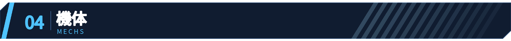

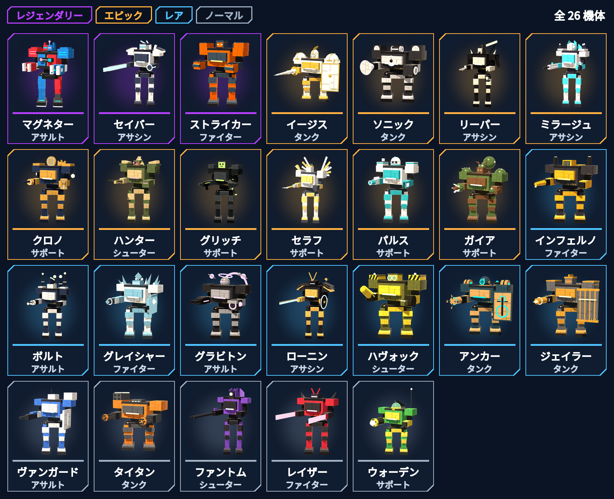

最初はノーマルの 5 機から。ほかの機体は、カプセルガチャで手に入る。

6 つのロールから、1 機ずつピックアップ。

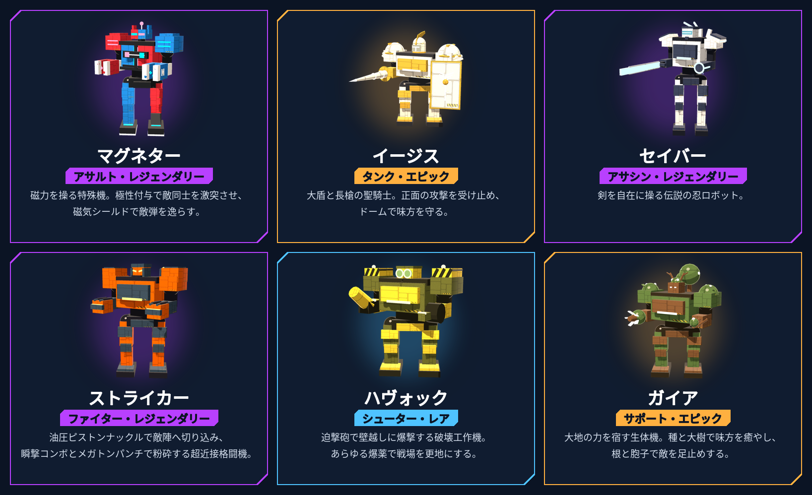

**PC**　W A S D で移動、マウスで狙って左クリックで撃つ。1・2・3 でスキル、Q で ULT、Space でブースト。

**スマホ**　左スティックで移動、右スティックで攻撃。スキルは、引いて離せば狙った方向へ。

**コントローラー**にも対応。

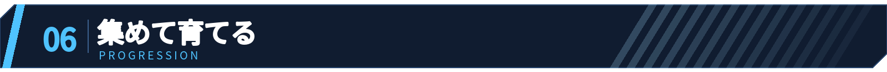

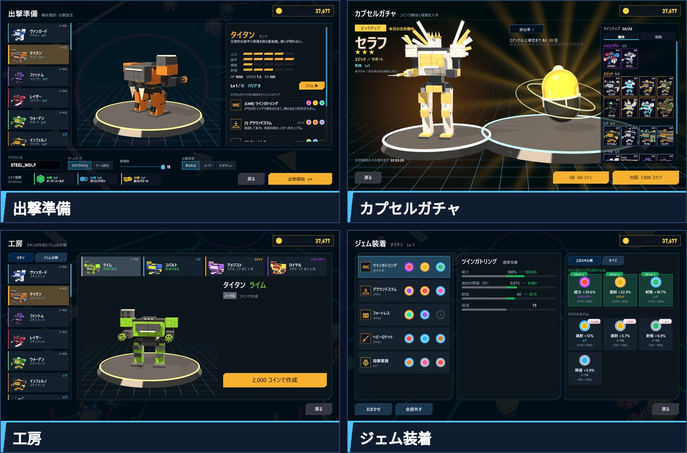

**カプセルガチャ**　コインで機体とコイン報酬を手に入れる。10 分に 1 回は無料。同じ機体が出たら、レベルアップ。

**工房**　全機体に 4 種類のスキン。作った姿は、マルチプレイでほかのプレイヤーにも見える。

**ジェム**　敵を倒すと手に入るジェムを、通常攻撃・スキル・ULT にはめて強化。

**刻印**　メダルとコアを使って、ジェムをその機体・その技だけの専用品に生まれ変わらせる。付く追加効果はランダム。狙うは、レジェンダリーのジェムにレジェンダリーの刻印。ジェムと刻印を組み合わせて、最強のカスタマイズを目指せ。

**ログインボーナスとランキング**　1 日 1 回のログインボーナス。持ち帰ったコインと撃破数は、unityroom のランキングへ。

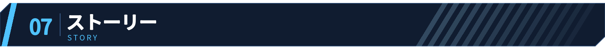

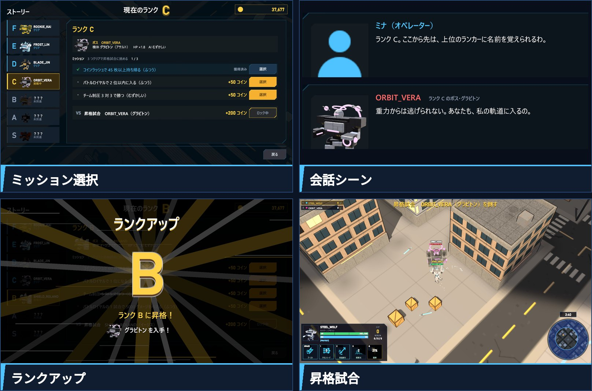

**Steam 版・Android 版・iOS 版（準備中）に入る、ひとり用のストーリーモード。**

新米パイロットとして、ランク F から頂点のランク S、そして「王者」を目指す。 
相棒はオペレーターのミナ。行く手には、各ランクに 1 人ずつ、合わせて 7 人のライバルが待ち構える。 
ミッションをこなして昇格試合に挑み、勝てばライバルの機体が自分のものに。全ランクを制覇したら、ライバル連戦で最速記録に挑戦だ。

- 不具合の報告と要望の置き場。issue だけを置いている。
- ゲーム内のチャットなどで寄せられた声をもとに、開発者が issue を作る。
- 対応したら、調べたこと・直したことを issue のコメントに書いて閉じる。ゲームへの反映は、次の更新から。
- [開いている issue](https://github.com/enyaorc/SteelRoyale-feedback/issues)　|　[対応済みの issue](https://github.com/enyaorc/SteelRoyale-feedback/issues?q=is%3Aissue%20state%3Aclosed)

 

画像の文字：Noto Sans JP（SIL Open Font License 1.1）

